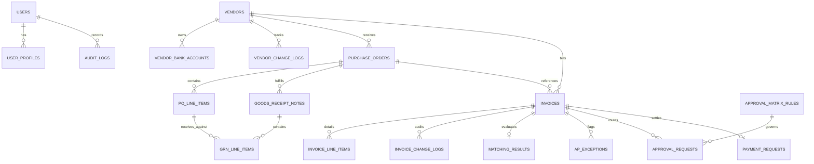

# PostgreSQL Database Schema & Relational Model
**Project:** Accounts Payable (AP) Automation Software with OCR  
**Client / Assessment:** Templegate Technologies & Services Pvt. Ltd.  
**Database:** PostgreSQL 15+ / 16  

---

## 1. Entity-Relationship (ER) Diagram

---

## 2. Table Definitions & PostgreSQL DDL Specifications

### 2.1 Core Authentication & Security
#### `apps_core_userprofile`
| Column | Type | Constraints / References | Description |
| :--- | :--- | :--- | :--- |
| `id` | UUID | PRIMARY KEY | Profile unique identifier |
| `user_id` | INTEGER | FOREIGN KEY $\rightarrow$ `auth_user(id)` UNIQUE | Django auth user reference |
| `role` | VARCHAR(30) | NOT NULL | `AP_CLERK`, `FINANCE_MANAGER`, `CONTROLLER`, `CFO`, `PURCHASING`, `WAREHOUSE`, `ADMIN` |
| `department` | VARCHAR(100) | NOT NULL | e.g. "Accounts Payable", "Procurement", "Finance" |
| `approval_limit_inr` | NUMERIC(14, 2) | NOT NULL, DEFAULT 50000.00 | Monetary signing limit |
| `phone_number` | VARCHAR(20) | NULLABLE | Contact number |
| `created_at` | TIMESTAMPTZ | NOT NULL, DEFAULT NOW() | Profile timestamp |

#### `apps_core_auditlog`
| Column | Type | Constraints / References | Description |
| :--- | :--- | :--- | :--- |
| `id` | UUID | PRIMARY KEY | Audit log identifier |
| `user_id` | INTEGER | FOREIGN KEY $\rightarrow$ `auth_user(id)` NULLABLE | User performing the action |
| `user_display` | VARCHAR(150) | NOT NULL | Full name and role snapshot |
| `action` | VARCHAR(80) | NOT NULL, INDEXED | e.g. `INVOICE_FIELD_EDITED`, `APPROVAL_DECISION` |
| `entity_type` | VARCHAR(60) | NOT NULL | `Invoice`, `PurchaseOrder`, `VendorBankAccount` |
| `entity_id` | VARCHAR(100) | NOT NULL | Target entity identifier |
| `old_values` | JSONB | NULLABLE | Snapshot prior to change |
| `new_values` | JSONB | NULLABLE | Snapshot after change |
| `reason` | TEXT | NULLABLE | Mandatory explanation for human edits |
| `timestamp` | TIMESTAMPTZ | NOT NULL, INDEXED, DEFAULT NOW() | Immutable timestamp |

---

### 2.2 Vendor Master
#### `apps_vendors_vendor`
| Column | Type | Constraints / References | Description |
| :--- | :--- | :--- | :--- |
| `id` | UUID | PRIMARY KEY | Vendor unique identifier |
| `vendor_code` | VARCHAR(50) | UNIQUE, INDEXED | e.g. `VEND-101` |
| `name` | VARCHAR(255) | NOT NULL, INDEXED | Registered company name |
| `trade_name` | VARCHAR(255) | NULLABLE | Trade / doing-business-as name |
| `gstin` | VARCHAR(15) | UNIQUE, INDEXED | 15-character Indian GSTIN |
| `pan` | VARCHAR(10) | NULLABLE | 10-character Permanent Account Number |
| `is_msme` | BOOLEAN | NOT NULL, DEFAULT FALSE | MSME Section 43B(h) compliance flag |
| `msme_reg_number` | VARCHAR(50) | NULLABLE | Udyam Registration Number |
| `payment_terms_days` | INTEGER | NOT NULL, DEFAULT 30 | Standard credit period |
| `status` | VARCHAR(20) | NOT NULL | `ONBOARDING`, `ACTIVE`, `BLOCKED`, `INACTIVE` |
| `is_gstin_verified` | BOOLEAN | NOT NULL, DEFAULT TRUE | Government GST portal status |

#### `apps_vendors_vendorbankaccount`
| Column | Type | Constraints / References | Description |
| :--- | :--- | :--- | :--- |
| `id` | UUID | PRIMARY KEY | Account unique identifier |
| `vendor_id` | UUID | FOREIGN KEY $\rightarrow$ `apps_vendors_vendor(id)` | Parent vendor |
| `account_number` | VARCHAR(50) | NOT NULL (Stored securely) | Beneficiary bank account |
| `account_holder_name`| VARCHAR(255) | NOT NULL | Name as registered with bank |
| `ifsc_code` | VARCHAR(11) | NOT NULL | 11-character RBI IFSC code |
| `bank_name` | VARCHAR(150) | NOT NULL | Bank institution name |
| `is_primary` | BOOLEAN | NOT NULL, DEFAULT TRUE | Default disbursement account |
| `is_verified` | BOOLEAN | NOT NULL, DEFAULT FALSE | Penny drop verification flag |
| `verification_reference`| VARCHAR(100)| NULLABLE | Bank webhook reference ID |

---

### 2.3 Procurement (Purchase Orders & GRN)
#### `apps_procurement_purchaseorder`
| Column | Type | Constraints / References | Description |
| :--- | :--- | :--- | :--- |
| `id` | UUID | PRIMARY KEY | Purchase Order identifier |
| `po_number` | VARCHAR(50) | UNIQUE, INDEXED | e.g. `PO-2026-001` |
| `vendor_id` | UUID | FOREIGN KEY $\rightarrow$ `apps_vendors_vendor(id)` | Selected supplier |
| `issue_date` | DATE | NOT NULL | Order date |
| `subtotal` | NUMERIC(14, 2) | NOT NULL, DEFAULT 0.00 | Sum of line totals |
| `tax_amount` | NUMERIC(14, 2) | NOT NULL, DEFAULT 0.00 | Total GST tax |
| `total_amount` | NUMERIC(14, 2) | NOT NULL, DEFAULT 0.00 | Gross order value |
| `status` | VARCHAR(30) | NOT NULL | `OPEN`, `PARTIALLY_RECEIVED`, `FULLY_RECEIVED`, `CLOSED` |

#### `apps_procurement_polineitem`
| Column | Type | Constraints / References | Description |
| :--- | :--- | :--- | :--- |
| `id` | UUID | PRIMARY KEY | Line item identifier |
| `po_id` | UUID | FOREIGN KEY $\rightarrow$ `purchaseorder(id)` | Parent PO |
| `line_number` | INTEGER | NOT NULL | Sequence index (1, 2, 3...) |
| `material_code` | VARCHAR(50) | NOT NULL, INDEXED | Item SKU / Material ID |
| `description` | VARCHAR(255) | NOT NULL | Item description |
| `ordered_quantity` | NUMERIC(12, 3) | NOT NULL | Quantity ordered |
| `received_quantity` | NUMERIC(12, 3) | NOT NULL, DEFAULT 0.000 | Cumulative received via GRNs |
| `unit_price` | NUMERIC(12, 2) | NOT NULL | Agreed unit rate |
| `uom` | VARCHAR(20) | NOT NULL, DEFAULT 'NOS' | Unit of Measure |

#### `apps_procurement_goodsreceiptnote` (GRN)
| Column | Type | Constraints / References | Description |
| :--- | :--- | :--- | :--- |
| `id` | UUID | PRIMARY KEY | GRN unique identifier |
| `grn_number` | VARCHAR(50) | UNIQUE, INDEXED | e.g. `GRN-2026-101` |
| `po_id` | UUID | FOREIGN KEY $\rightarrow$ `purchaseorder(id)` | Linked PO |
| `receipt_date` | DATE | NOT NULL | Physical gate entry date |
| `delivery_note_number`| VARCHAR(100)| NULLABLE | Vendor delivery challan # |
| `status` | VARCHAR(30) | NOT NULL | `RECEIVED`, `INSPECTED_ACCEPTED`, `REJECTED` |

---

### 2.4 Invoices & OCR
#### `apps_invoices_invoice`
| Column | Type | Constraints / References | Description |
| :--- | :--- | :--- | :--- |
| `id` | UUID | PRIMARY KEY | Invoice unique identifier |
| `invoice_number` | VARCHAR(100) | NOT NULL, INDEXED | Vendor invoice number |
| `vendor_id` | UUID | FOREIGN KEY $\rightarrow$ `vendor(id)` NULLABLE | Identified vendor |
| `po_id` | UUID | FOREIGN KEY $\rightarrow$ `purchaseorder(id)` NULLABLE | Matched PO |
| `invoice_date` | DATE | NULLABLE | Billing date |
| `due_date` | DATE | NULLABLE | Payment due date |
| `grand_total` | NUMERIC(14, 2) | NOT NULL | Total payable amount |
| `file_attachment` | VARCHAR(100) | NOT NULL | File storage location |
| `file_hash_sha256` | VARCHAR(64) | NOT NULL, INDEXED | Cryptographic hash for duplicate prevention |
| `ocr_confidence_score`| NUMERIC(5, 2)| NOT NULL, DEFAULT 0.00 | Average extraction confidence |
| `has_sensitive_edits` | BOOLEAN | NOT NULL, DEFAULT FALSE | Flags manual edits to financial fields |
| `status` | VARCHAR(30) | NOT NULL, INDEXED | `UPLOADED`, `EXTRACTED`, `NEEDS_VERIFICATION`, `PENDING_AP_REVIEW`, `MATCH_PASSED`, `MATCH_FAILED`, `PENDING_APPROVAL`, `APPROVED`, `PAID` |

#### `apps_invoices_invoicechangelog`
| Column | Type | Constraints / References | Description |
| :--- | :--- | :--- | :--- |
| `id` | UUID | PRIMARY KEY | Change log record identifier |
| `invoice_id` | UUID | FOREIGN KEY $\rightarrow$ `invoice(id)` | Target invoice |
| `user_display` | VARCHAR(150) | NOT NULL | User who made the change |
| `field_name` | VARCHAR(100) | NOT NULL | Modified field (e.g. `quantity`, `unit_price`) |
| `old_value` | TEXT | NULLABLE | Previous value |
| `new_value` | TEXT | NULLABLE | Corrected value |
| `reason` | TEXT | NOT NULL | Mandatory explanation for modification |
| `is_sensitive` | BOOLEAN | NOT NULL, DEFAULT FALSE | Requires secondary AP review |
| `reviewed_by_ap` | BOOLEAN | NOT NULL, DEFAULT FALSE | AP clearance status |

---

### 2.5 Exceptions & Matching
#### `apps_exceptions_mgmt_apexception`
| Column | Type | Constraints / References | Description |
| :--- | :--- | :--- | :--- |
| `id` | UUID | PRIMARY KEY | Exception unique identifier |
| `category` | VARCHAR(50) | NOT NULL, INDEXED | One of the 16 Templegate exception categories |
| `severity` | VARCHAR(20) | NOT NULL | `BLOCKING`, `WARNING`, `INFO` |
| `invoice_id` | UUID | FOREIGN KEY $\rightarrow$ `invoice(id)` NULLABLE | Target invoice |
| `description` | TEXT | NOT NULL | Plain-language issue description |
| `assigned_role` | VARCHAR(30) | NOT NULL | e.g. `AP_CLERK`, `PURCHASING`, `WAREHOUSE` |
| `resolved` | BOOLEAN | NOT NULL, DEFAULT FALSE, INDEXED | Resolution status |
| `resolution_notes` | TEXT | NULLABLE | Explanatory note of resolution action |

#### `apps_matching_matchingresult`
| Column | Type | Constraints / References | Description |
| :--- | :--- | :--- | :--- |
| `id` | UUID | PRIMARY KEY | Matching result identifier |
| `invoice_id` | UUID | ONE-TO-ONE $\rightarrow$ `invoice(id)` | Target invoice |
| `match_type` | VARCHAR(20) | NOT NULL | `TWO_WAY` or `THREE_WAY` |
| `status` | VARCHAR(30) | NOT NULL | `MATCHED`, `PRICE_MISMATCH`, `QTY_MISMATCH`, `MISSING_GRN` |
| `price_tolerance_percent` | NUMERIC(5, 2) | NOT NULL, DEFAULT 1.00 | Applied tolerance threshold |
| `is_passed` | BOOLEAN | NOT NULL, DEFAULT FALSE | Matching pass indicator |
| `item_matching_details` | JSONB | NULLABLE | Line-by-line 3-way variance grid |
| `override_approved` | BOOLEAN | NOT NULL, DEFAULT FALSE | Manager override flag |
| `override_reason` | TEXT | NULLABLE | Documented override justification |

---

### 2.6 Workflows & Approvals
#### `apps_workflows_approvalmatrixrule`
| Column | Type | Constraints / References | Description |
| :--- | :--- | :--- | :--- |
| `id` | UUID | PRIMARY KEY | Rule identifier |
| `name` | VARCHAR(150) | NOT NULL | Rule description |
| `min_amount` | NUMERIC(14, 2) | NOT NULL | Lower threshold |
| `max_amount` | NUMERIC(14, 2) | NOT NULL | Upper threshold |
| `required_role` | VARCHAR(30) | NOT NULL | `FINANCE_MANAGER`, `CONTROLLER`, `CFO` |
| `tier_order` | INTEGER | NOT NULL | Execution sequence (Tier 1, 2, 3) |
| `sla_hours` | INTEGER | NOT NULL, DEFAULT 48 | Hours before escalation |

#### `apps_workflows_approvalrequest`
| Column | Type | Constraints / References | Description |
| :--- | :--- | :--- | :--- |
| `id` | UUID | PRIMARY KEY | Request identifier |
| `invoice_id` | UUID | FOREIGN KEY $\rightarrow$ `invoice(id)` | Invoice pending approval |
| `tier_order` | INTEGER | NOT NULL | Current tier level |
| `status` | VARCHAR(20) | NOT NULL, INDEXED | `PENDING`, `APPROVED`, `REJECTED`, `ESCALATED` |
| `comments` | TEXT | NULLABLE (Mandatory on rejection) | Approver remarks |
| `actioned_at` | TIMESTAMPTZ | NULLABLE | Timestamp of approval decision |
| `escalation_deadline`| TIMESTAMPTZ | NOT NULL | SLA expiry timestamp |

---

### 2.7 Payments & Settlements
#### `apps_payments_paymentrequest`
| Column | Type | Constraints / References | Description |
| :--- | :--- | :--- | :--- |
| `id` | UUID | PRIMARY KEY | Payment request identifier |
| `invoice_id` | UUID | ONE-TO-ONE $\rightarrow$ `invoice(id)` | Approved invoice settled |
| `vendor_id` | UUID | FOREIGN KEY $\rightarrow$ `vendor(id)` | Beneficiary |
| `bank_account_id` | UUID | FOREIGN KEY $\rightarrow$ `vendorbankaccount(id)` | Disbursed account |
| `gross_amount` | NUMERIC(14, 2) | NOT NULL | Invoice grand total |
| `tds_rate_percent` | NUMERIC(5, 2) | NOT NULL, DEFAULT 0.10 | Withholding tax rate |
| `tds_amount` | NUMERIC(14, 2) | NOT NULL | Withholding tax deducted |
| `net_payable_amount`| NUMERIC(14, 2) | NOT NULL | Final disbursed amount |
| `status` | VARCHAR(20) | NOT NULL, INDEXED | `PENDING_APPROVAL`, `PROCESSING`, `COMPLETED`, `FAILED` |
| `utr_number` | VARCHAR(50) | UNIQUE, NULLABLE | Core bank settlement reference |
| `advice_pdf` | VARCHAR(100) | NULLABLE | Generated PDF remittance advice |
